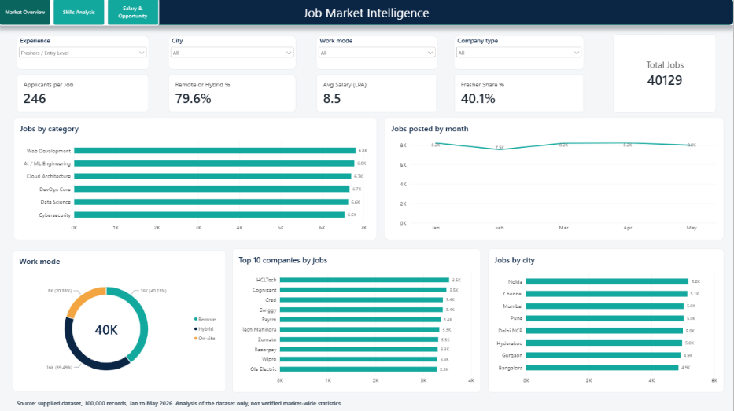
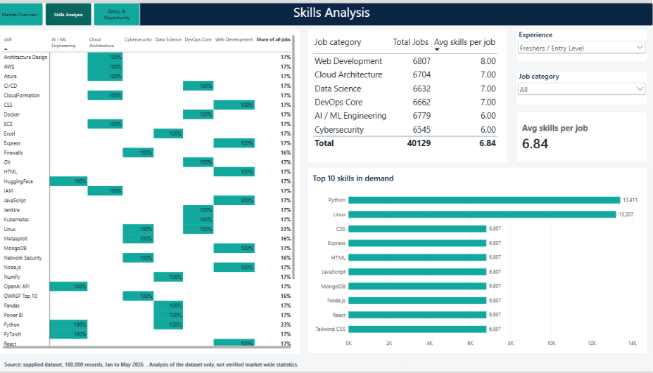
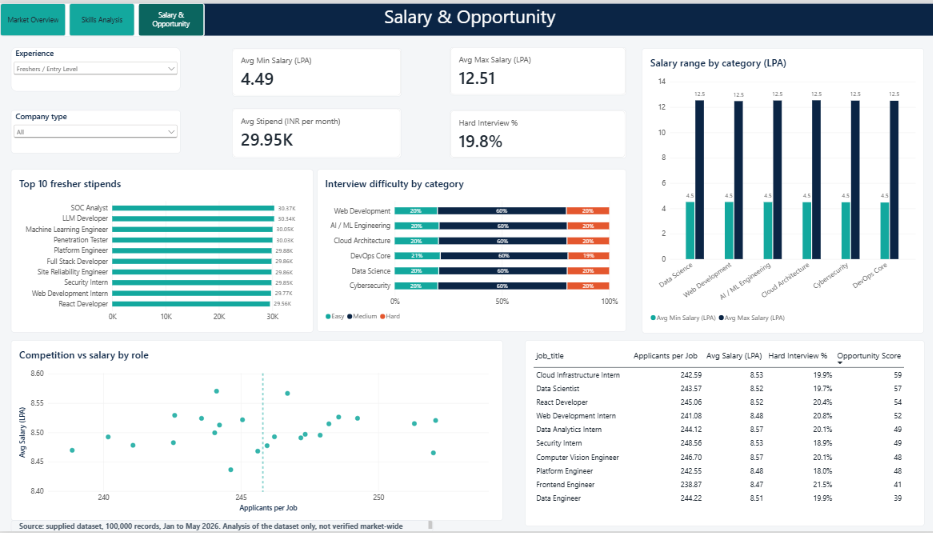
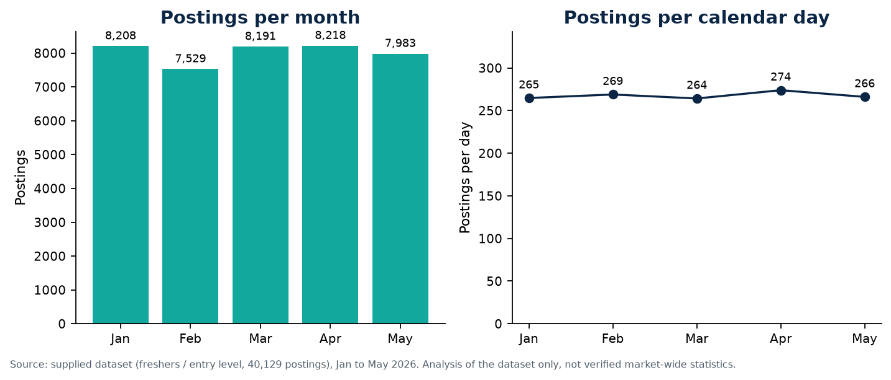
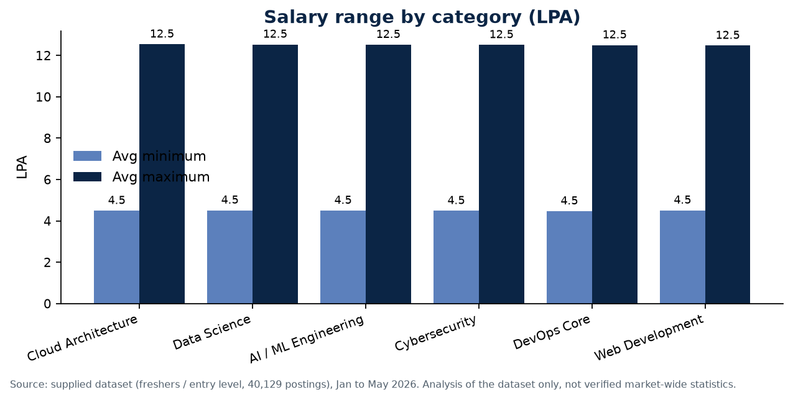
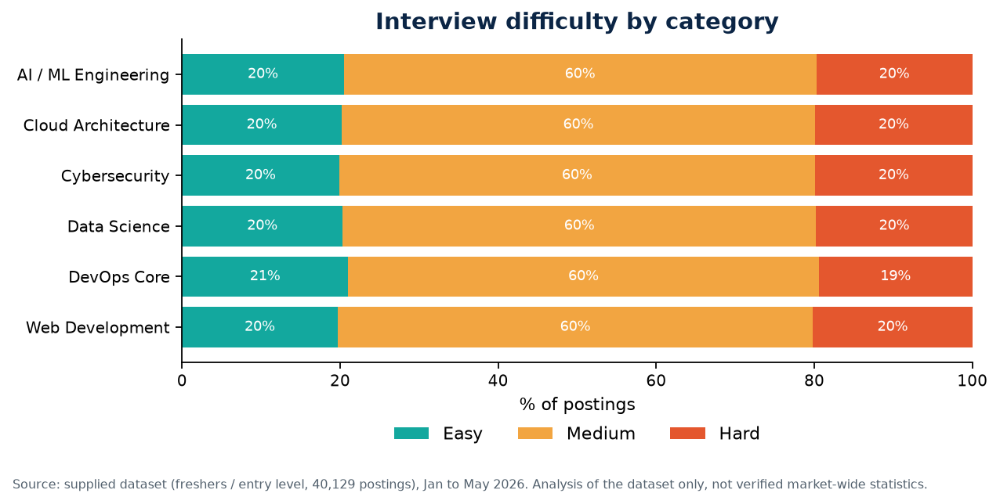

# Job Market Intelligence & Skills Analysis for IT Freshers in India

An end-to-end data analytics project that uses **Python (Pandas, Matplotlib)**, **Oracle SQL** and **Power BI (DAX)** to analyze 100,000 job-posting records: roles, skills, locations, work modes, experience levels, salaries and applicant competition, with a focus on software development and IT freshers.

**Author:** Avishkar Padhen

> **Note on the data:** the dataset's provenance and licence have not been independently verified, and it may not consist of genuine live postings. All findings describe the supplied dataset only, not verified market-wide facts. The full dataset is not included in this repository. See [Data limitations](#data-limitations) and [`data/README.md`](data/README.md).

## Highlights

- Cleaned and standardized **100,000 records** (date parsing, salary conversion to LPA, missing-value handling, multi-skill field split).
- Built a **Jobs-to-Skills data model** with a date table and custom **DAX measures** in Power BI.
- Delivered a **3-page interactive Power BI dashboard** (Market Overview, Skills Analysis, Salary & Opportunity) and **7 static Python charts**.
- Validated every dashboard KPI against the source data and documented the dataset's quality issues.

## Tech stack

| Stage | Tools |
|---|---|
| Data cleaning and analysis | Python 3.10+, Pandas, NumPy |
| Static charts | Matplotlib |
| Querying | Oracle SQL |
| Dashboard | Power BI Desktop, DAX, Power Query |
| Editor | VS Code |

## Project structure

```text
Job_Market_Intelligence_Project/
├── data/
│   ├── raw/                        # place jobs_original.csv here (not tracked)
│   ├── sample/jobs_sample.csv      # 1,000-row excerpt to try the pipeline
│   └── processed/                  # generated files; small summaries are tracked
├── python/
│   ├── clean_jobs_data.py
│   ├── analyze_jobs.py
│   ├── prepare_oracle_csv.py
│   ├── prepare_powerbi_data.py
│   └── create_visualizations.py
├── sql/
│   ├── create_jobs_real.sql
│   └── job_market_analysis.sql
├── powerbi/
│   ├── POWER_BI_GUIDE.md
│   ├── dax_measures.dax
│   ├── job_market_theme.json
│   └── screenshots/
├── visuals/                        # PNG charts from create_visualizations.py
├── reports/PROJECT_REPORT.md
├── requirements.txt
├── LICENSE
└── README.md
```

## Power BI dashboard

Screenshots are taken with the Experience slicer on **Freshers / Entry Level**.

**Market Overview**



**Skills Analysis**



**Salary & Opportunity**



- **Market Overview:** total jobs, fresher share, average salary, applicants per job, remote or hybrid share, plus jobs by category, month, city, work mode and top companies.
- **Skills Analysis:** top 10 skills, a skill-by-category heatmap, and average skills per job by category.
- **Salary & Opportunity:** salary range by category, top fresher stipends, competition versus salary by role, interview difficulty by category, and a role comparison table with an Opportunity Score.

**Data model:** `Jobs` (one row per posting, from `powerbi_jobs.csv`) relates one-to-many to `Skills` (one row per posting and skill, from `powerbi_job_skills.csv`) on `job_id`. A `Calendar` table relates to `Jobs[posted_date]`. Measures are in [`powerbi/dax_measures.dax`](powerbi/dax_measures.dax) and the colour theme is [`powerbi/job_market_theme.json`](powerbi/job_market_theme.json). Build steps are in [`powerbi/POWER_BI_GUIDE.md`](powerbi/POWER_BI_GUIDE.md).

## Python visualizations

Seven static charts (freshers / entry-level roles) are saved in [`visuals/`](visuals/). A few examples:







Regenerate them with `python python/create_visualizations.py` (add `--all-roles` to include all experience levels).

## Key findings (supplied dataset)

1. **Fresher share:** 40,129 of 100,000 postings (40.1%) are entry-level roles.
2. **Demand by category:** the six categories are close in size, from 16,425 (Data Science) to 16,872 (Web Development) postings.
3. **Posting volume:** monthly postings range from 18,787 (February) to 20,643 (January). Per day, volume is steady at roughly 660 to 670 postings, so the February dip reflects the shorter month.
4. **Work mode:** Remote 40.0%, Hybrid 39.7%, On-site 20.3%, so about 80% of postings are remote or hybrid.
5. **Salary:** the average salary midpoint is about 8.5 LPA, with postings ranging from about 3 to 18 LPA (average minimum 4.5, average maximum 12.5). Averages are almost identical across categories, company types and experience levels.
6. **Competition:** about 247 applicants per posting, with roles ranging only from about 244 to 252.
7. **Skills:** Python and Linux are the most frequent skills (about 33,000 postings each) because each appears in two categories; every other skill belongs to a single category.
8. **Interview difficulty:** about 60% Medium, 20% Easy and 20% Hard in every category.

## Data limitations

Profiling the dataset showed patterns that real job-board data rarely has:

- Salaries, applicant counts, cities, work modes and platforms are spread almost perfectly evenly.
- Every fresher role is "Contractual" and every mid-senior role is "Permanent".
- Each job category lists a fixed set of skills, so skill demand mirrors category demand.

These patterns suggest the dataset may be generated. The project therefore demonstrates the **analysis method** (cleaning, modelling, SQL, DAX, validation and storytelling) rather than real market trends.

## Requirements

- Python 3.10 or later
- VS Code (or any editor)
- Oracle Database and an Oracle extension or SQL client (SQL stage only)
- Power BI Desktop (dashboard stage only)

## How to run

Run all commands from the project root.

### 0. Get the data

The full dataset is not in this repository. Either place your copy at `data/raw/jobs_original.csv`, or try the pipeline with the included 1,000-row sample (results will differ from the figures above):

```bash
cp data/sample/jobs_sample.csv data/raw/jobs_original.csv
```

On Windows PowerShell: `Copy-Item data\sample\jobs_sample.csv data\raw\jobs_original.csv`.

### 1. Create and activate a virtual environment (recommended)

Windows PowerShell:
```powershell
python -m venv .venv
.\.venv\Scripts\Activate.ps1
```

macOS/Linux:
```bash
python3 -m venv .venv
source .venv/bin/activate
```

### 2. Install packages

```bash
python -m pip install -r requirements.txt
```

### 3. Run the pipeline

```bash
python python/clean_jobs_data.py          # creates data/processed/jobs_cleaned.csv
python python/analyze_jobs.py             # summary CSVs in data/processed/
python python/prepare_oracle_csv.py       # creates jobs_oracle_import.csv (14 columns)
python python/prepare_powerbi_data.py     # creates powerbi_jobs.csv and powerbi_job_skills.csv
python python/create_visualizations.py    # saves PNG charts in visuals/
```

## Oracle SQL

1. Connect to your Oracle database in VS Code.
2. Run `sql/create_jobs_real.sql` once to create `JOBS_REAL`.
3. Import `jobs_oracle_import.csv` with your Oracle import tool, mapping columns to table columns and omitting the identity-generated `JOB_ID`.
4. Check the imported row count:
   ```sql
   SELECT COUNT(*) FROM JOBS_REAL;
   ```
5. Run the queries in `sql/job_market_analysis.sql`.

If `JOBS_REAL` already exists, do not rerun the `CREATE TABLE` statement. Check the current table before importing again to avoid duplicate rows.

## Power BI

1. Run `python python/prepare_powerbi_data.py` to create the two Power BI tables.
2. Follow [`powerbi/POWER_BI_GUIDE.md`](powerbi/POWER_BI_GUIDE.md) to load the CSVs, create the relationship and Calendar table, add the measures from `dax_measures.dax` and apply the theme.
3. Save the report as `powerbi/Job_Market_Intelligence.pbix`. If you open it on another machine, update the data source paths under Home > Transform data > Data source settings.

## Report

The full write-up, with methodology, data-quality notes and results, is in [`reports/PROJECT_REPORT.md`](reports/PROJECT_REPORT.md).

## Licence

The code is released under the [MIT Licence](LICENSE). The licence does **not** cover the dataset, whose terms have not been verified.
